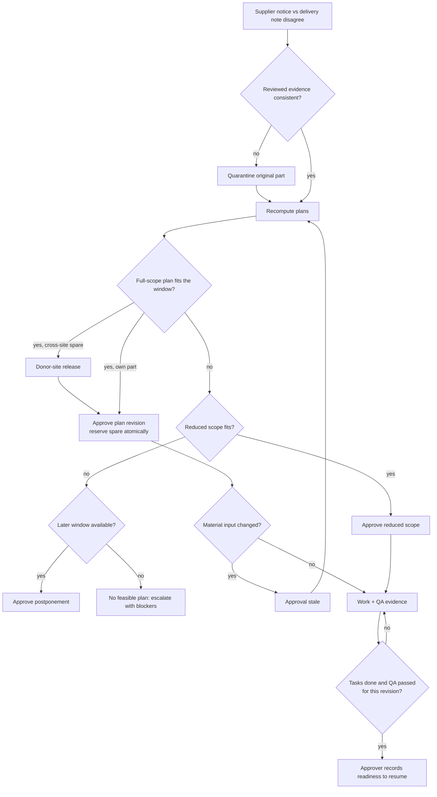
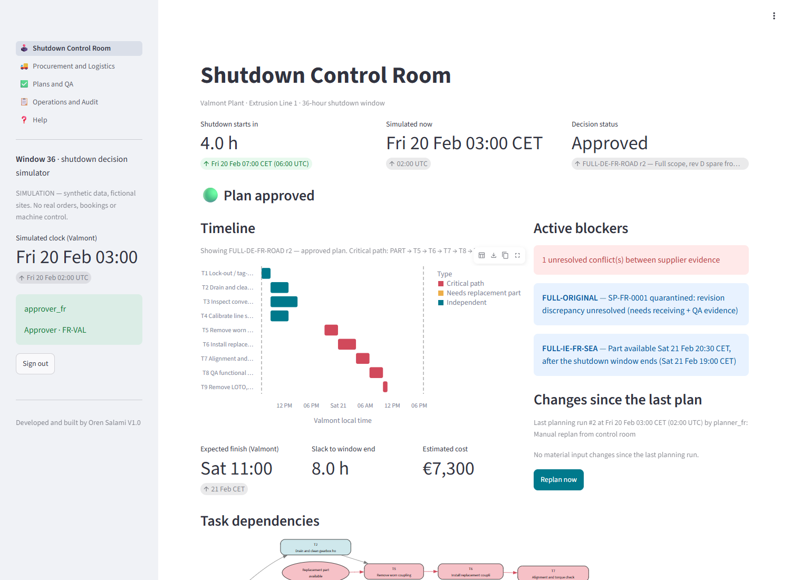
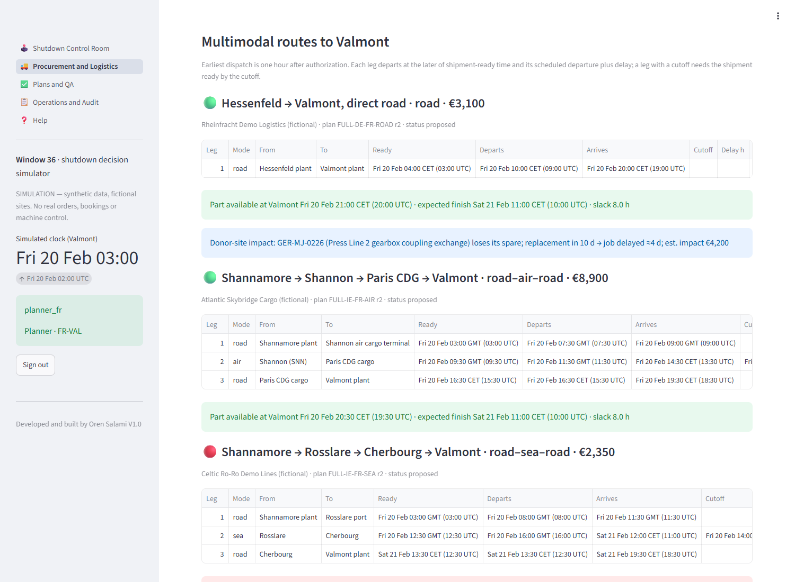
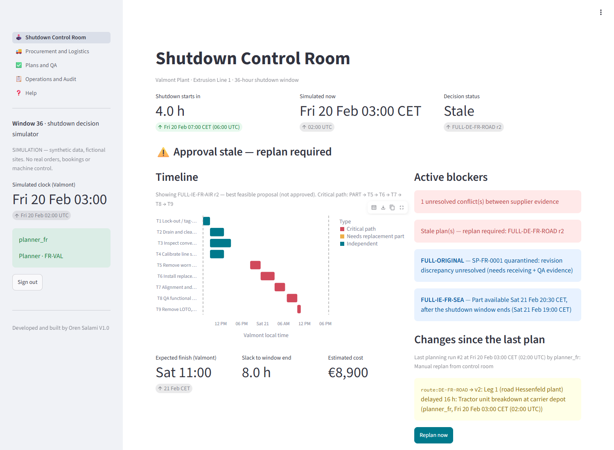
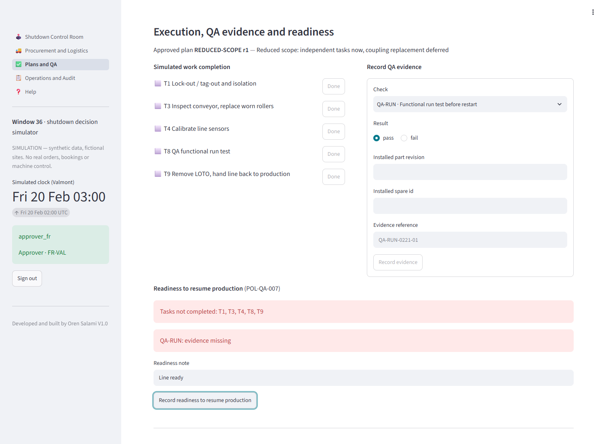

# Window 36 — shutdown decision simulator

**Developed and built by Oren Salami V1.0**

## What it does

Window 36 helps a plant manager decide whether to **start, reduce or postpone** a 36-hour production
shutdown when the critical spare part becomes unavailable four hours before the window opens. It joins
procurement evidence, inventory and reservations across three sites, multimodal logistics (road,
road–air–road, road–sea–road), task scheduling, QA evidence and approvals into one workflow — and keeps a
full audit trail of who decided what, on which plan revision, under which policy.

It is a **planning and approval simulator on synthetic data**. Sites, parts, carriers, costs and procedures
are fictional. It places no orders, books no carriers, takes no payments and controls no machinery.

## Why it matters

When a part is in doubt hours before a shutdown, the real decision is spread across emails, spreadsheets and
phone calls: is the delivered revision right, can another plant spare one, which route still makes the
cutoff, what does the donor site lose, and is the line actually safe to restart? Window 36 shows that
decision in one place, recomputes it when facts change, and refuses to let a decision outlive the facts it
was based on: approvals bind to an immutable plan revision and input versions, and go **stale** when an
input changes.

## Run it

Requires Docker with Compose. From a fresh clone:

```bash
docker compose up --build
```

Open <http://localhost:8501> (bound to localhost only). Compose starts PostgreSQL, applies migrations,
seeds the demo idempotently, then starts the Streamlit UI. Data persists in the `w36_pgdata` volume;
`docker compose down -v` removes it.

Sign in with a demo account — `planner_fr`, `operator_fr`, `approver_fr`, `approver_de`, `approver_ie`,
`viewer` and others (listed in the in-app **Help Center**). The local-demo password is `window36-demo`; set
your own in `.env` (copy [`.env.example`](.env.example)). Port in use? Set `W36_UI_PORT`.

## Demo in two minutes

> New to Window 36? Open **Help Center** (first item in the app's sidebar, no sign-in needed). It explains
> the scenario, walks through the demo step by step, describes every screen and status, and lists the accounts.

1. **Procurement and Logistics** (`planner_fr`): review the two staged documents — the supplier notice says
   rev C, the delivery note says rev B. The part is quarantined.
2. **Shutdown Control Room**: *Replan now*. Compare the options: German road transfer and Irish air fit;
   Irish sea is cheaper but arrives after the window ends.
3. **Plans and QA**: `approver_de` releases the German spare; `approver_fr` approves `FULL-DE-FR-ROAD`.
4. **Operations and Audit** (`planner_fr`): apply *Road pickup delay* — the approval goes **stale** and the
   spare returns to the German job. Apply *Missed air cargo cutoff*, then replan: no full-scope plan fits.
5. `approver_fr` approves **REDUCED-SCOPE**. Readiness stays **blocked** until `operator_fr` completes the
   tasks and records passing QA evidence for that exact plan revision.



## Screenshots

| | |
|---|---|
|  |  |
|  |  |

## More

- [Architecture](docs/architecture.md) — modules, data model, planning rules
- [Governance, security and operations](docs/governance-operations.md) — policies, roles, controls, CI, logs
- [Demo and verification runbook](docs/demo-runbook.md) — step-by-step demo and recorded test results

Developer loop: `pip install -r requirements-dev.txt`, then `ruff check .` and `pytest` (integration and UI
tests need `W36_TEST_DATABASE_URL` pointing at a disposable PostgreSQL database).
