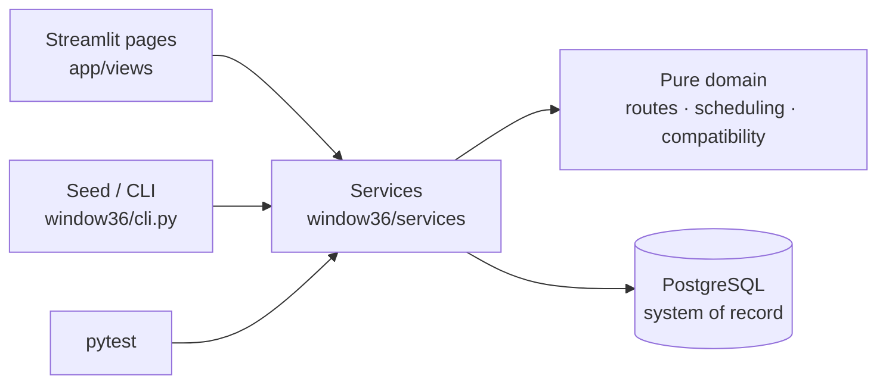

# Architecture

A modular monolith: one Python package (`window36`), one Streamlit UI (`app/`), one PostgreSQL database.
No separate API, queue, worker or dashboard service.

| Layer | Contents |
|---|---|
| `window36/domain` | Pure, deterministic functions: route evaluation, task scheduling, time-zone windows, revision compatibility. No database access. |
| `window36/services` | Business rules and transactions: `documents` + `extraction` (intake), `inventory` (stock, reservations, receiving), `planning`, `approvals`, `qa`, `events`, `policies`, `scenario`, `health`, `auth`. Every write checks permissions here. |
| `app/` | Streamlit pages. Holds only UI state (who is signed in); calls services; never writes to the database directly. |
| `migrations/` | Alembic schema, partial unique indexes and database guards. |

## Data model (main tables)

`site`, `app_user`, `stock_item`, `compatibility_rule`, `site_job` (donor job holding a spare),
`reservation`, `shutdown`, `task`, `staff_calendar`, `route`, `route_leg`, `document`, `extracted_fact`,
`fact_conflict`, `planning_run`, `plan`, `approval`, `external_event`, `entity_sequence`,
`input_version`, `input_change`, `work_record`, `qa_evidence`, `audit_event`, `scenario_state`.

All timestamps are `timestamptz` in UTC. Each site and each route-leg endpoint carries an IANA time zone;
the UI shows local time with UTC in brackets.

## Planning rules (deterministic, no solver)

* **Candidates** per run: full scope with the original delivery, full scope with each cross-site route
  (one per route), reduced scope (independent tasks only) and postponement to the next window.
* **Routes** — earliest dispatch is one hour after authorization. A leg departs at the later of
  shipment-ready time (previous arrival + handoff buffer) and its scheduled departure plus any delay. A leg
  with a cutoff requires the shipment to be ready by the cutoff. After the last leg the part waits for the
  destination's receiving hours, then one hour of goods-in inspection.
* **Scheduling** — tasks in dependency order (ties by code). A task starts at the earliest time that
  satisfies the window start, predecessors, part availability (if it needs the part) and a free crew of its
  skill inside that crew's local working hours. The critical path is traced back from the last task through
  whichever constraint bound each start.
* **Feasibility** — a plan is feasible when the part is usable (compatible, not quarantined or rejected,
  not claimed elsewhere), the route meets its cutoffs, and the schedule finishes inside the window. Every
  infeasible option lists the computed reasons.
* **Costs** — transport legs, donor-site impact, deferred-replacement risk or postponement (all
  fictional estimates).

The seeded constraints fit this simple list scheduler; a solver was not needed.

## Plan revisions, approvals and staleness

* Each planning run stores a new **immutable** plan revision only when the outcome or input versions changed
  (a fingerprint compares them). A database trigger rejects any update to a plan except its status.
* Every plan records the versions of the inputs it used (`stock:…`, `route:…`, `shutdown:…`,
  `tasks:…`, `staff:…`, `sitejob:…`). A material change bumps the input version, logs an `input_change`,
  and marks affected open plans and their approvals **stale**; reserved spares are released back to the
  donor job. Approving a stale or superseded revision is refused.
* Approvals are bound to one plan revision. Idempotency keys plus a partial unique index
  (`one active decision per plan and type`) make repeated or concurrent requests return the same decision.

## Consistency

* **One active claim per spare**: `SELECT … FOR UPDATE` on the stock row plus the partial unique index
  `uq_reservation_one_active_claim`.
* **Events**: `event_id` is unique (`INSERT … ON CONFLICT DO NOTHING`); duplicates are counted, not
  re-applied. Each entity has a sequence; an older sequence is stored as `out_of_order` and not applied.
* Each UI action or service call is one transaction; blocked attempts are audited in a separate
  transaction so the refusal is recorded even though the action rolls back.

## Document extraction

`DocumentExtractor` is the substitution point. The shipped implementation,
`DeterministicFixtureExtractor`, is a rule-based parser of `KEY: value` text with line provenance — **no AI
model**. A model-driven extractor is **not included in V1** and therefore unverified; if added, it must
implement the same interface and feed the same staging and review flow. Extraction can never approve plans,
reserve stock or trigger actions.
